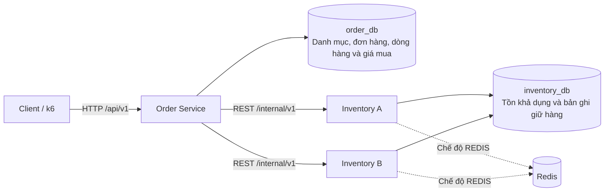

# Flash Sale Platform

Hệ thống backend mô phỏng flash sale, nơi nhiều khách cùng mua một sản phẩm có tồn kho giới hạn. Dự án kiểm chứng cách ngăn bán vượt tồn, tránh trừ kho hai lần khi client gửi lại yêu cầu và phục hồi khi phản hồi bị mất sau khi giao dịch đã commit.

**Công nghệ:** Java 21, Spring Boot, Spring Data JPA và JDBC, PostgreSQL, Flyway, Redis/Redisson, Maven, Testcontainers, Docker Compose và k6.

## Kiến trúc



Order Service sở hữu danh mục và đơn hàng. Inventory Service là nguồn dữ liệu tồn kho, với hai bản sao dùng chung một PostgreSQL riêng. Order gọi luân phiên hai địa chỉ Inventory qua REST. Mỗi dịch vụ tự quản lý migration Flyway và chỉ truy cập trực tiếp cơ sở dữ liệu của mình. [Quyết định tách dịch vụ](docs/adr/ADR-002-service-boundaries.md)

### Giữ hàng và xử lý lỗi

- **ATOMIC** là chế độ mặc định. PostgreSQL trừ kho bằng một câu lệnh `UPDATE ... WHERE stock >= quantity`, trong cùng giao dịch với bản ghi giữ hàng. `PESSIMISTIC` khóa dòng, `OPTIMISTIC` kiểm tra phiên bản và `REDIS` dùng Redisson kết hợp kiểm tra phiên bản trong PostgreSQL. `NONE` phục vụ kịch bản minh họa mất cập nhật và bị vô hiệu hóa trong Compose mặc định. [Chiến lược khóa và API Inventory](docs/INVENTORY_SERVICE.md)
- **Idempotency và retry.** Order commit đơn `PENDING` và giá mua trước khi gọi Inventory. Yêu cầu trùng `Idempotency-Key` đọc lại đơn hiện có. Inventory chống trừ kho lặp theo `orderId`. Các lần gọi lại có giới hạn và dùng lại cùng mã đơn.
- **Đối soát và bù trừ.** Đơn còn chờ trả `202`. Bộ đối soát tra cứu để xác nhận `CONFIRMED` hoặc quyết định hủy. Khi hủy, Order ghi `cancel_requested` trước khi gọi release. Inventory hoàn kho tối đa một lần hoặc ghi dấu hủy để chặn yêu cầu giữ hàng đến muộn. Order chỉ chuyển sang `REJECTED` khi Inventory xác nhận kết quả cuối. [Vòng đời và sơ đồ tuần tự](docs/VONG_DOI_DON_HANG.md)

## Chạy thử

Cần Docker với BuildKit, Docker Compose từ 2.20.3 và Python 3. Ví dụ HTTP dùng thêm `curl` và `jq`. Chạy từ thư mục gốc. [Yêu cầu phiên bản Docker Compose](https://docs.docker.com/compose/how-tos/multiple-compose-files/include/)

```bash
export COMPOSE_PROJECT_NAME=flash-sale-demo
docker compose up --build -d --wait
curl -fsS http://127.0.0.1:8080/actuator/health
python3 scripts/smoke-orders.py
```

Compose cung cấp cấu hình mặc định để chạy cục bộ. Có thể đặt `ORDER_PORT` trước khi khởi động và đổi cổng tương ứng trong các lệnh `curl`. Order được mở trên loopback. Inventory, PostgreSQL và Redis dùng mạng Docker.

### Tạo sản phẩm và mua hàng

```bash
api=http://127.0.0.1:8080/api/v1

product_id=$(curl -fsS "$api/products" -H 'Content-Type: application/json' \
  -d '{"name":"Bàn phím demo","price":25,"initialStock":5}' | jq -er '.id')

key="demo-$product_id"
order_id=$(curl -fsS "$api/orders" -H 'Content-Type: application/json' \
  -H "Idempotency-Key: $key" \
  -d "{\"productId\":$product_id,\"quantity\":2}" | jq -er '.id')

curl -fsS "$api/orders/$order_id"
```

`POST /api/v1/orders` trả `201` khi đơn mới đã xác nhận, `200` khi gửi lại khóa của đơn đã xác nhận, `202` khi đơn đang chờ và `409` khi đơn bị từ chối hoặc payload xung đột với khóa đã dùng. Gửi lại cùng khóa và payload hoặc dùng `GET /api/v1/orders/{id}` để kiểm tra trạng thái.

### Kiểm thử và dừng

```bash
mvn -B clean verify
python3 scripts/smoke-orders.py --recovery
docker compose down
```

Maven cần Java 21 và Docker để chạy Testcontainers. Tùy chọn `--recovery` chỉ dùng trên project thử nghiệm vì script dừng hai bản sao Inventory, khởi động lại Order và đối chiếu dữ liệu đã commit trong hai DB.

## Kết quả kiểm chứng

**72 lượt đo, 237.961 yêu cầu HTTP, không có sai lệch tồn kho** và không còn đơn `PENDING` cuối mỗi lượt. Trong diễn tập dừng Inventory và khởi động lại Order, **96/96 đơn đang chờ** được xác nhận. Ở lượt lặp với gián đoạn kéo dài qua nhiều chu kỳ đối soát, đơn lâu nhất hoàn tất sau **27,87 giây**. [Kết quả kiểm thử độ tin cậy](docs/KIEM_THU_DO_TIN_CAY.md)

Thông lượng xác nhận trung vị của ba lượt, chế độ ATOMIC, tính theo đơn đã commit mỗi giây.

| VU | Monolith | Order + Inventory |
| ---: | ---: | ---: |
| 20 | 359,7 | 116,0 |
| 100 | 484,5 | 170,7 |
| 200 | 663,9 | 212,2 |

Monolith có thông lượng xác nhận cao hơn ở cả 12 tổ hợp chế độ khóa và mức tải. Tách dịch vụ xác định rõ chủ sở hữu tồn kho. Mỗi lượt mua cần thêm một chặng HTTP và các giao dịch riêng. Vận hành cần thêm đối soát, bù trừ và sao lưu đồng bộ hai DB. Benchmark chạy ngắn trên một máy Docker với tải vòng kín. Cấu hình Compose dành cho chạy thử cục bộ. Khả năng mở rộng đa máy, chuyển đổi dự phòng PostgreSQL và thời gian phục hồi khi mất kết nối kéo dài vẫn cần kiểm chứng. [Phương pháp, số liệu gốc và cách tái hiện](docs/benchmarks/README.md)

## Tài liệu và mốc Git

- [Vòng đời đơn hàng](docs/VONG_DOI_DON_HANG.md) · [Chuyển dữ liệu tồn kho](docs/CHUYEN_DU_LIEU_TON_KHO.md)
- [ADR về ATOMIC trong monolith](docs/adr/ADR-001-inventory-locking-strategies.md) · [ADR về ranh giới dịch vụ](docs/adr/ADR-002-service-boundaries.md) · [ADR về giữ hàng và đối soát](docs/adr/ADR-003-reservation-and-reconciliation.md)
- [`monolith-v1` (`3ae96ef`)](https://github.com/Hoangg-Thien/flash-sale-platform/tree/monolith-v1) là mốc đối chiếu monolith. [Kiểm chứng monolith hai instance](multi-instance.md)
