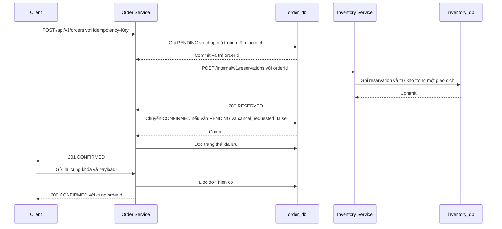
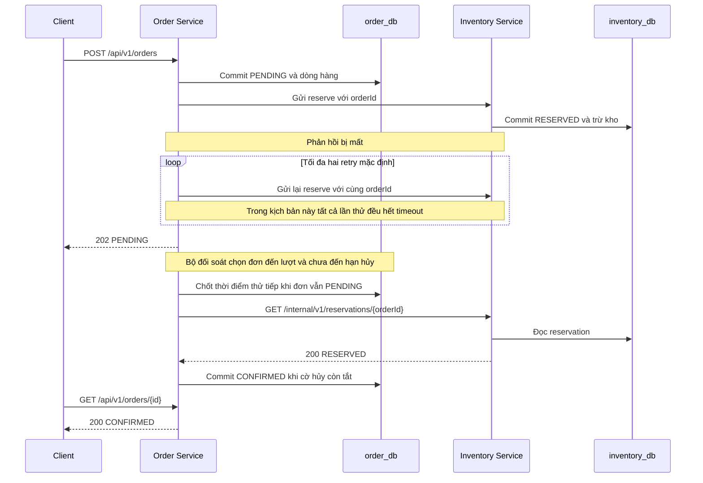
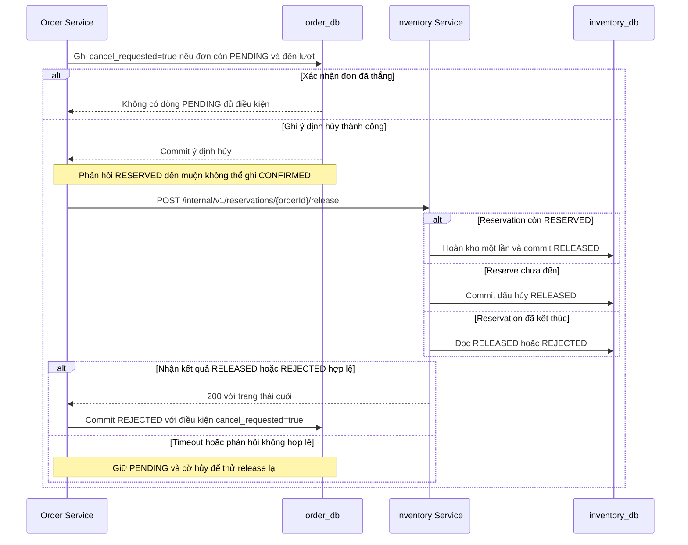

# Vòng đời đơn hàng

Mỗi lần mua có hai mã. Khách hàng tạo `Idempotency-Key` cho một lần mua và dùng lại khóa đó khi gửi lại yêu cầu. Order cấp `orderId` trong PostgreSQL. Mọi thao tác giữ hàng, tra cứu và hủy ở Inventory dùng cùng `orderId`. Order gửi mã sản phẩm và số lượng khi giữ hàng hoặc hủy, rồi đối chiếu các trường này với phản hồi.

## Giao dịch mua

1. Order kiểm tra khóa dài từ 1 đến 64 ký tự, mã sản phẩm, số lượng từ 1 đến 100 và tình trạng khởi tạo kho. Trong một giao dịch cục bộ, Order chèn đơn `PENDING` bằng `ON CONFLICT DO NOTHING` trên chỉ mục duy nhất của khóa, rồi lưu số lượng và giá mua vào `order_items`. Khi hai yêu cầu cùng tranh một khóa, PostgreSQL phân xử bên chèn. Bên còn lại đọc bản ghi đã commit và đối chiếu dữ liệu. Dữ liệu khác trả về `409`.
2. Sau khi giao dịch kết thúc, Order gọi `POST /internal/v1/reservations`. Inventory xác nhận giao dịch tồn kho và lượt giữ hàng trong cơ sở dữ liệu riêng. Mất phản hồi tại đây có thể để lại một đơn đang chờ với hàng đã giữ thành công.
3. Order chỉ nhận kết quả từ phản hồi HTTP 200 có mã đơn, mã sản phẩm, số lượng khớp và trạng thái hợp lệ. Một câu lệnh cập nhật có điều kiện ghi kết quả cuối. Order đọc lại trạng thái đã lưu trước khi trả lời. Lần gửi lại khóa của khách hàng chỉ đọc đơn hiện tại.
4. HTTP `201` biểu thị đơn mới đã xác nhận, `200` là đọc lại đơn đã xác nhận, `202` là đơn còn chờ và `409` là đơn bị từ chối hoặc khóa xung đột. GET theo mã đơn trả `200` với cả ba trạng thái hoặc `404` nếu chưa có đơn.

## Đối soát và hủy

| Trạng thái đã lưu ở Order | Thao tác của tác vụ đối soát | Điều kiện kết thúc |
| --- | --- | --- |
| `PENDING`, chưa yêu cầu hủy | GET trạng thái tại Inventory. Nếu GET trả 404, gửi lại yêu cầu giữ hàng với đúng mã đơn. | `RESERVED` cho phép xác nhận. `REJECTED` hoặc `RELEASED` cho phép từ chối. |
| `PENDING`, đã yêu cầu hủy | Gửi lại yêu cầu release. Inventory khóa bản ghi giữ hàng, hoàn kho một lần, hoặc ghi dấu hủy nếu yêu cầu giữ hàng chưa đến. | Chỉ `RELEASED` hoặc `REJECTED` mới cho phép từ chối. |
| `CONFIRMED`, `REJECTED` | Hai trạng thái cuối. Tác vụ chỉ chọn các đơn đang chờ. | |

Trước khi gọi release, tác vụ **ghi và xác nhận** cờ `cancel_requested` với điều kiện đơn vẫn là `PENDING`. Luồng mua chỉ được xác nhận nếu đơn vẫn đang chờ và cờ này còn tắt. PostgreSQL phân xử hai cập nhật tranh cùng dòng. Nếu xác nhận thắng, tác vụ hủy không lấy được quyền gọi release. Nếu hủy thắng, phản hồi `RESERVED` đến muộn không thể xác nhận đơn. Một yêu cầu giữ hàng đến sau dấu hủy chỉ đọc lại `RELEASED`. Quy tắc này yêu cầu mọi bên vận hành dùng Order làm chủ thể quyết định hủy, kể cả khi xử lý sự cố.

Cờ hủy, thời điểm thử tiếp và dữ liệu yêu cầu đều nằm trong PostgreSQL. Sau khi tiến trình khởi động lại, tác vụ tiếp tục theo cờ đã lưu. Hết thời gian chờ, mất kết nối, dữ liệu trả về sai hoặc phản hồi hủy không rõ kết quả đều để đơn ở `PENDING`. Nếu dịch vụ mất kết nối lâu, đơn có thể chờ lâu hơn ngưỡng hủy.

## Sơ đồ tuần tự

### Mua hàng thành công

### Hết timeout sau khi Inventory đã commit

Nếu GET reservation trả `404` trước hạn hủy, Order gửi lại reserve với cùng mã đơn và payload. Nếu kết quả vẫn chưa rõ, đơn tiếp tục chờ lượt đối soát sau.

### Hủy và bù trừ khi đến hạn

## Cấu hình

| Thuộc tính Spring | Mặc định | Ý nghĩa |
| --- | --- | --- |
| `inventory.base-urls` | `http://localhost:8081` | Danh sách địa chỉ phân cách bằng dấu phẩy. Compose dùng hai bản sao chung một cơ sở dữ liệu. Các lần gọi luân phiên địa chỉ. |
| `inventory.connect-timeout-ms`, `inventory.read-timeout-ms` | 500, 2000 | Thời gian chờ kết nối và đọc phản hồi, tính bằng mili giây. |
| `inventory.retries` | 2 | Số lần thử lại tối đa sau lần gọi đầu. Các lần thử chờ lần lượt 50 và 100 ms. |
| `orders.reconcile-delay-ms`, `orders.reconcile-age-ms` | 1000, 5000 | Thời gian nghỉ giữa các lượt quét và tuổi tối thiểu của đơn để xử lý. Mỗi lượt chọn tối đa 32 đơn, ưu tiên thời điểm thử cũ nhất. |
| `orders.cancel-age-ms` | 60000 | Tuổi đơn để tác vụ chuyển sang hủy. Việc chuyển phụ thuộc thời điểm tác vụ thực sự xử lý đơn. |

## Kiểm chứng

`mvn clean verify` chạy các kiểm thử PostgreSQL và HTTP có điều khiển thứ tự phản hồi. Các trường hợp gồm hai yêu cầu tranh cùng khóa, phản hồi giữ hàng đến sau khi hoàn kho, mất phản hồi sau khi Inventory ghi nhận, và khởi động lại Order. Khi cố ý chặn phản hồi, kiểm thử cũng đọc `pg_stat_activity` để phát hiện giao dịch Order còn mở. Kiểm thử của Inventory đối chiếu tồn kho và bản ghi giữ hàng trên hai JVM.

Trên project Compose dành riêng cho thử nghiệm, chạy `python3 scripts/smoke-orders.py --recovery` để kiểm tra hai cơ sở dữ liệu thật trong lúc dừng Inventory và khởi động lại Order. Trước khi đo tải hoặc thử sự cố mất máy, cần chọn ngưỡng chấp nhận cho tuổi đơn chờ, cố định cấu hình máy và chuẩn bị quy trình phục hồi đồng bộ hai cơ sở dữ liệu.
